[Home - AD160 - Build apps and web APIs with ABAP Cloud using agentic AI](../../README.md)

# Getting Started

## Introduction
Welcome to **AD160 (aka RAP 130)**! 

Before building your app, you need to set up your development environment in Visual Studio Code to connect it to your ABAP system.

In this exercise, you prepare your PC/laptop to run this tutorial.

> ℹ️ **Info**: If you participate an SAP event, such as SAP TechEd, pre-configured laptops are provided. So, only then VS Code, the [**ABAP Development Tools for VS Code**](https://marketplace.visualstudio.com/items?itemName=SAPSE.adt-vscode) extension, and GitHub Copilot is installed and prepared for you.

<!--
> ℹ️ **Info**: If you participate an SAP event, such as America's SAP Users' Group (ASUG), you should have installed **Visual Studio Code**, the **ABAP Development Tools for VS Code** extension, and **GitHub Copilot** as coding agent.  
-->

---

**Table of Contents**
- [Introduction](#introduction)
- [Important Information](#important-information)
- [System and Logon Information](#system-and-logon-information)
- [Exercises](#exercises)
- [Summary & Next Exercise](#summary--next-exercise)

---


## 🔴 Important Information

> **📌 Note**   
> We’ve got sessions running in several locations. Please pick the one that’s right for you!

> **📌 Replace the three digits to get your group number `###`:**
>  - `ZAD160_AI_DEMO_###` → 001-041 → SAP TechEd Berlin, October 27-29, 2026
<!--
>  - `ZAD160_AI_DEMO_###` → 042-080 → SAP TechEd Berlin, October 27-29, 2026
>  - `ZAD160_AI_DEMO_###` → 001-041 → SAP ASUG Tech Connect, Fort Worth, November 2-4, 2026
-->

---

## 🔐 System and Logon Information

<table>
  <tr>
    <th>Key</th>
    <th>Value</th>
  </tr>
  <tr>
    <td>SAP BAIP, ABAP environment - <b>T02</b> -</td>
    <td> ⚠ The SAP system URL will be provided by your instructors! ⚠</td>
    <!-- https://url.sap/vq6gf5 -->
  </tr>
  <tr>
    <td>User</td>
    <td>ad160-###@education.cloud.sap (where '###' is your assigned group ID)</td>
  </tr>
  <tr>
    <td>Password</td>
    <td>⚠ will be provided by your instructors ⚠</td>
  </tr>
  <tr>
    <td>Exercise ABAP Package</td>
    <td>ZAD160_AI_DEMO_### (where '###' is your assigned group ID)
      <br/><br><i>Don't forget to replace all occurences of the placeholder '###' with your assigned location and group ID in the exercise steps below.</i></td>
  </tr>
</table>

<!--
## Prerequisites

Ensure that you have installed a coding agent, e.g. [GitHub Copilot](https://github.com/features/copilot) and have a **valid license**. See [here](https://sap.sharepoint.com/teams/AIPairProgrammingwithGitHubCopilot/SitePages/Setting-up-Copilot.aspx).

Ensure that your ABAP system contains and has access to the [ABAP Flight Reference Scenario](https://help.sap.com/docs/abap-cloud/abap-rap/abap-flight-reference-scenario).
-->

---

### Exercises
- [0.1 - Open Visual Studio Code](#exercise-01-open-visual-studio-code)
- [0.2 - Connect Visual Studio Code to Your ABAP Cloud System](#exercise-02-connect-visual-studio-code-to-your-abap-system)
- [0.3 - Handle your Group ID](#exercise-03-handle-your-group-id)
- [0.4 - Open your ABAP Package](#exercise-04-open-your-abap-package)
- [0.5 - Verify the Installation](#exercise-05-verify-the-installation)
- [0.6 - Explore the User Interface of Visual Studio Code User for ABAP Development](#exercise-06-explore-the-user-interface-of-visual-studio-code-for-abap-development)
- [Summary & Next Exercise](#summary--next-exercise)

<!--
- [0.1 - Install Visual Studio Code](#exercise-01-install-visual-studio-code)
- [0.2 - Install the ABAP Development Tools Extension](#exercise-02-install-the-abap-development-tools-for-vs-code-extension)
- [0.3 - Connect Visual Studio Code to Your ABAP Cloud System](#exercise-03-connect-visual-studio-code-to-your-abap-system)
- [0.4 - Handle your Group ID](#exercise-04-handle-your-group-id)
- [0.5 - Open your ABAP Package](#exercise-05-Open-your-abap-package)
- [0.6 - Verify the Installation](#exercise-06-verify-the-installation)
- [0.7 - Explore the User Interface of Visual Studio Code User for ABAP Development](#exercise-07-explore-the-user-interface-of-visual-studio-code-for-abap-development)
- [Summary](#summary)
-->

---

## Exercise 0.1: Open Visual Studio Code
[^Top of page](#)

> Open Visual Studio Code that is already installed on your laptop. 

<details>
  <summary>🔵 Click to expand!</summary>

   1. Doulble-click the VS Code shortcut on your desktop.

 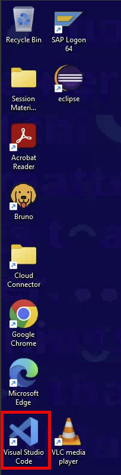

  > ℹ️ **NOTE**: The [**ADT for VS Code**](https://marketplace.visualstudio.com/items?itemName=SAPSE.adt-vscode) extension is also already installed into your Visual Studio Code installation. This extension enables you for ABAP development and contains the built-in ADT MCP Server with the ADT MCP Tools.

</details>

<!-- 
## Exercise 0.1: Install Visual Studio Code
[^Top of page](#)

> ℹ️ **Info**: Alternatively to this exercise, you can follow the tutorial [ABAP Development Tools for Visual Studio Code tutorial](https://developers.sap.com/tutorials/abap-environment-adt-vscode?from=abap-development-tools-for-visual-studio-code) to install Visual Studio Code (VS Code) and the **ABAP Development Tools for VS Code** extension from the Microsoft Marketplace.

> Install [Visual Studio Code](https://code.visualstudio.com/) as your open source AI code editor. Download and install it on your local drive.
<details>
  <summary>🔵 Click to expand!</summary>

1. Open the [download page](https://code.visualstudio.com/Download) page of VS Code Studio in your browser.

2. Select and download the installer of your operating system (Windows, macOS, or Linux).

   > ℹ️ **NOTE**: In this sample, Microsoft Windows is used as operating system for demo purpose.

        

      The installation file is downloaded in your default download folder
      
3. Select and run the installer and follow the on-screen instructions.

      

4. Launch **Visual Studio Code** once the installation is complete.

   > ℹ️ **Hint**: Ensure you are running a recent and stable version of Visual Studio Code. To check your version, go to **Help > About** in the menu. The version will then be displayed in a dialog to be opened.

</details>
-->

<!--
## Exercise 0.2: Install the ABAP Development Tools for VS Code Extension
[^Top of page](#)

   > ℹ️ **NOTE**: For SAP events, the **ABAP Development Tools for VS Code** extension is already installed on your laptop. You need nothing to install at this point.  

>  The **ABAP Development Tools (ADT) for VS Code** extension is SAP's efficient and feature‑rich environment for ABAP development within the ABAP Cloud development model. Install it from the [**Microsoft Marketplace**](https://marketplace.visualstudio.com/items?itemName=SAPSE.adt-vscode) into your Visual Studio Code installation. This extension enables you for ABAP development and connects Visual Studio Code to your ABAP backend. It also includes the built-in ADT MCP Server and ADT MCP Tools.

<details>
  <summary>🔵 Click to expand!</summary>

### Step 1: Install from the Microsoft Marketplace

1. Open **Visual Studio Code**.

2. To open the **Extensions** view ...  
   a. Choose **`Ctrl+Shift+X`** (macOS: **`Cmd+Shift+X`**), or  
   b. Click the **Extensions** icon in the **Activity Bar** (left edge)

      

3. In the input field on top of the view, type and search for **`ABAP Development Tools`**.

      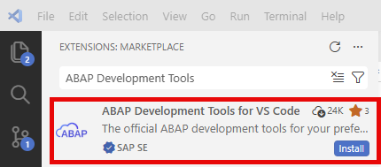

4. Select the **`ABAP Development Tools for VS Code`** extension published by **SAP** and click **Install**.

      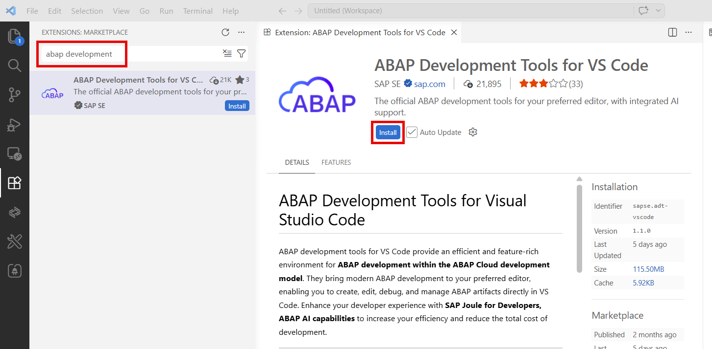

5. Wait for the installation to be completed.

The ADT extension should be installed and opens the **ABAP Development Tools for VS Code** page.

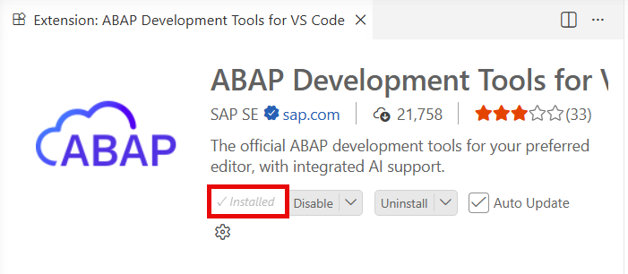  

   > ✅ **Success**: In the **Extensions** activity bar, you should see the `ABAP Development Tools` item listed under **Installed** extensions.   
   > Alternatively, you can enter `@installed` in the input field. You then get a list with the installed extensions.
  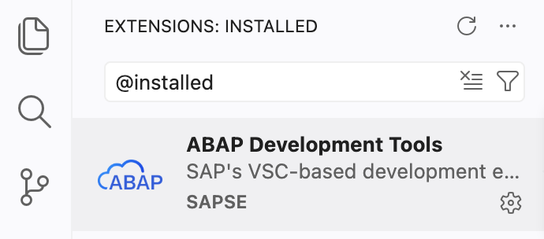
   
</details>

-->

---

## Exercise 0.2: Connect Visual Studio Code to Your ABAP System
[^Top of page](#)

> Create a **destination** to establish a system connection to your ABAP system and add it to your workspace.  
> Choose the connection type that matches your system:
> - **HTTP** — SAP Business AI Platform or SAP S/4HANA Cloud Public Edition  
<!-- 
> - **RFC** — SAP S/4HANA or SAP S/4HANA Cloud Private Edition (requires SAP Logon configured on your machine)
-->

<details>
  <summary>🔵 Click to expand!</summary>

### Option A: Destination for Cloud systems

1. Open the **Command Palette** using **`Ctrl+Shift+P`**.

2. Type 'ABAP: New Destination' and select **`ABAP: New Destination...`**.

3. Select **HTTP** as the connection type.

4. Enter the ABAP service instance URL as the **System URL** of your ABAP Cloud system.

    > ℹ️ **Note**: You find the short link of the system URL on your handout.  
    a. Open a browser.  
    b. Type the short link to the **System:** URL into the address bar. You find the short link to the URL in your handout.  
    c. Confirm with `Enter`.  
    The relevant system URL will be resolved.  
    d. Copy and paste the resolved URL for this step!

5. Press **`Enter`**, then type a short **ID** for this destination (e.g., `AD160`<!-- `RAP130`-->).

6. Press **`Enter`**. 

    The connection is established and a dialog is opened. From here you can add the destination directly to your workspace.

   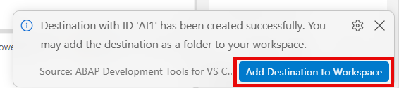

7. Choose the **`Add Destination to Workspace`** button.  
The destination appears in the workspace.


> ⚠️ Here is a summery of the relevant steps and data to be used: 

   ```
   Command Palette → 'ABAP: New Destination...'
     ↓
   Connection Type → HTTP
     ↓
   System URL → 'See handout'
           ↓
   Destination ID → 'See handout'
     ↓
   Add destination to the workspace
     ↓
   ✅ Connection established and displayed in the Explorer!
   ```

<!--
### Option B: Destination for classic SAP systems)

> ℹ️ **Prerequisite**: Your system must be configured and added in **SAP Logon pad** (SAP GUI) with RFC connectivity before proceeding.

1. Open the **Command Palette** using **`Ctrl+Shift+P`**.

2. Type 'ABAP: New Destination' and select **`ABAP: New Destination...`**.

3. Select **RFC** as the connection type.

4. A list of systems that is added in your **SAP Logon** configuration is displayed. Select your target system.

5. Enter your **`user name`** and press **`Enter`**.

6. Enter the **`client number`** (e.g., `100`) and press **Enter**.

7. Enter your **`logon language`** (e.g., `EN`) and press **Enter**.

8. Confirm or edit the name of destination.

9. Press **`Enter`**.
The connection is established and a dialog is opened. From here you can add the destination directly to your workspace.

   

10. Choose the **`Add Destination to Workspace`** button.  
The destination appears in the workspace.

   ```
   Command Palette → 'ABAP: New Destination...'
     ↓
   Connection Type → RFC
     ↓
   System → S4D - Development System
     ↓
   Username → DEVELOPER01
     ↓
   Client → 100
     ↓
   Language → EN
     ↓   
   Add destination to the workspace
     ↓
   ✅ Connection established!
   ```

-->

---

### Add the destination to your workspace

> ⚠️ **Important**:  
> - If you have already added the destination to your workspace, you can skip the following steps.  
> - If you miss the destination in your workspace in the **Explorer**, you need to follow the following steps:

1. Open the **Command Palette** using **`Ctrl+Shift+P`** (macOS: **`Cmd+Shift+P`**).

2. Type 'ABAP: Add Destination as Folder' and select **`ABAP: Add Destination as Folder to the Workspace...`**.

3. Select your newly created destination.

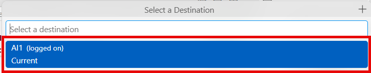


### Log on to your destination with your user

> Next, you need to log on to your ABAP system.

1. Select the destination in the **Explorer**.

2. Choose **Log On to Destination...** from the context menu.

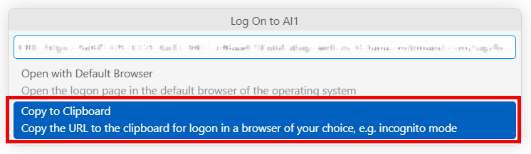

   The URL is stored in your clipboard.

3. Open a new window in icognito mode in your browser and paste the URL from the clipboard.

   The **Welcome to ABAP_TARGET2!** page is opened.  
   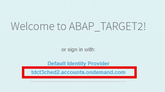

4. Choose the link to **'tdct3ched2.accounts.ondemand.com'**.  
   The **Sign In** page is opened.

   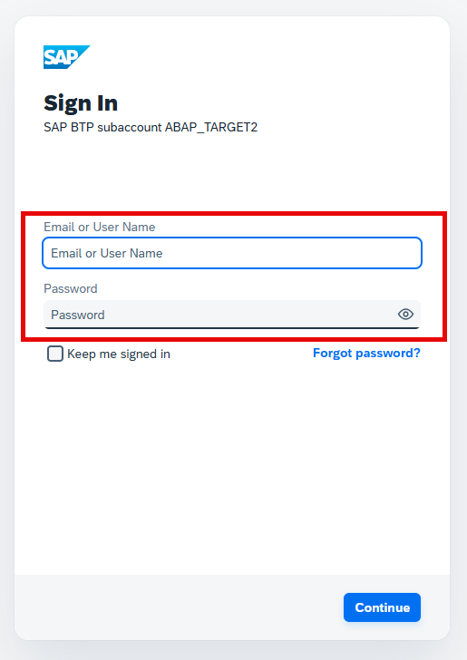

5. Enter your **`User`** and **`Password`** that will be provided by the instructor.

6. Confirm with **`Continue`**. 

    Your log on will be confirmed and the system structure of your destination becomes available in the **Explorer**.  
   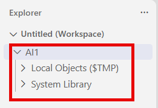

</details>

---

 ## Exercise 0.3: Handle your Group ID
[^Top of page](#)

> ℹ️ **NOTE**: For the SAP events, the group ID will be provided by the instructor. Use the given group ID for system logon, ABAP package name, and as suffix for the development objects to be created!

<!--
<details>
  <summary>🔵 Click to expand!</summary>

As the ABAP environment is shared by many participants, every artifact you create follows a naming pattern using a personal suffix.

> ℹ️ **NOTE**: The group ID can contain **a maximum of 3 characters (numbers and/or letters)** — e.g. `123`, `XY1`, or `ABC`.

> ⚠️ Do **not** use the group ID **`000`**. Choose your initials or a number combination that is unique to you.  

> ⚠️ Replace the placeholder **`###`** in all package names and object names throughout the exercises with your group ID.

**Check for already-used group IDs:**

1. Once Visual Studio Code is connected, open the **Command Palette** with **`Ctrl+Shift+P`** (macOS: **`Cmd+Shift+P`**).

2. Type **`>ABAP: Open Object`** and press **Enter**.

3. Search for **`ZAD160_AI_DEMO_###`**, replacing `###` with your chosen suffix.  
   > ℹ️ **NOTE**: If results appear, the group ID is already taken — try another one.

4. _No results_ means the group ID is available. 
   > ℹ️ **NOTE**: Note it down and use it consistently throughout all exercises.

</details>

-->

---

## Exercise 0.4: Open your ABAP Package 
[^Top of page](#)

> For this tutorial, the ABAP package `ZAD160_AI_DEMO_###` has already been created for you.

> ℹ️ **Note**:
> - Replace **`###`** with your group ID.
> - The screenshots are based on package `ZRAP130_AI_###`, but you will complete the tutorial in package `ZAD160_AI_DEMO_###`.

<details>
  <summary>🔵 Click to expand</summary>

1. Choose **`Ctrl+Shift+A`** to search and to open it.

2. Enter the **`ZAD160_AI_DEMO_###`** for the name of your ABAP package.

3. Select the relevant package in the proposal list.

The package will be opened in the **Explorer**.

</details>

<!--

## Exercise 0.6: Create an ABAP Package

[^Top of page](#)

> Create your exercise ABAP package.


<details>
  <summary>🔵 Click to expand - Package creation using ADT for Eclipse</summary>

1. Open **Eclipse ADT** and connect to your ABAP system.

2. In the **Project Explorer**, expand your system connection and right-click on **`ZLOCAL`** → **New → ABAP Package**.

3. Fill in the package details:
   - **Name**: `ZAD160_AI_DEMO_###` (replace `###` with your group ID)
   - **Description**: `RAP AI Package ###`
   - **Superpackage**: `ZLOCAL`
   - **Package Type**: `Development`

4. Click **Next** (or **Finish**), and assign the package to a transport request if prompted.

5. Verify the package **`ZAD160_AI_DEMO_###`** appears in the Project Explorer under `ZLOCAL`.

</details>

> ℹ️ **NOTE**: Everything has already been prepared for you. The relevant ABAP package has already been created for you. Please check your email account for further information. You can skip this step.

---   

<details>

<summary>🔵 Click to expand! - Package creation using ADT for VSCode</summary>

1. Open the **Command Palette (Ctrl+Shift+P)** and type 'ABAP'. You should see ABAP-specific commands. 

2. Choose **ABAP: Create New ABAP Object...**.
 
   [Open the command palette to start object creation](images/ex01_create_object_command_pallette.png)

3. Type 'package' and select **`Package Type: DEVC/K`** from the list.

   [Package type selection](images/ex01_create_object_package.png)

4. Enter the following details:
   - **Name**: `ZAD160_AI_DEMO_###` (replace `###` with your group ID)
   - **Description**: `RAP AI Package ###`
   - **Super Package**: `ZLOCAL`
   - **Software Component**: - (Leave this field blank!)

   [Sample where to enter the package name ](images/ex01_create_object_name.png)

5. Click **Enter** to trigger the package creation.
   
6. Verify the package **`ZAD160_AI_DEMO_###`** if it appears in the **Explorer** under `ZLOCAL`.

>ℹ️ **Note**: If the packge does **not** appear in the **Explorer**, open the **Command Palette** with **`Ctrl+Shift+P`** (macOS: **`Cmd+Shift+P`**). Type '>ABAP: Add Package as Folder to Workspace' and press **Enter**. Select then the relevant destination from proposal list and confirm with **Enter**. 

</details>

-->

---

## Exercise 0.5: Verify the Installation

Open ADT for VS Code and get familiar with the [ADT extension](https://help.sap.com/docs/abap-cloud/abap-development-tools-for-visual-studio-code/abap-development-tools-for-visual-studio-code).

<details>
 <summary>🔵 Click to expand!</summary>
1. Open the **Command Palette** (**`Ctrl+Shift+P`**) and type `ABAP`.  

You should see ABAP-specific commands such as:
  - `ABAP: New Destination...`  
  - `ABAP: Add Destination as Folder to Workspace` 
  - `ABAP: Open Object...` 
  - `ABAP: Create New ABAP Object...` 
  - `ABAP: Activate`  
  - ...


  >✅ If you see these commands, the extension is installed correctly.  
  >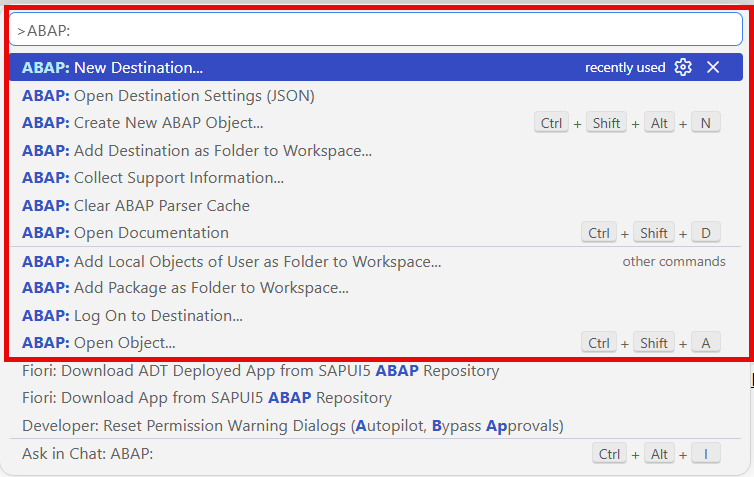  

</details>

---

## Exercise 0.6: Explore the User Interface of Visual Studio Code for ABAP Development
[^Top of page](#)

> Get familiar with the key Visual Studio Code areas and its [user interface](https://code.visualstudio.com/docs/editing/getting-started/userinterface) of VS Code.

<details>
  <summary>🔵 Click to expand!</summary>

### Key UI areas for ABAP development

| Area | Location | Purpose |
|------|----------|---------|
| **Activity Bar** | Far left | To switch between Explorer, Search, Source Control, Run & Debug, Extensions |
| **Command Palette** | At the top | To trigger features and functions |
| **Explorer (Workspace)** | Left sidebar | To navigate your ABAP system hierarchy — packages, object types, objects |
| **Editor** | Center | To edit ABAP source code (classes, CDS views, behavior definitions, etc.) |
| **Coding agent chat** (e.g. GitHub Copilot) | Right sidebar or panel | AI-powered chat — you will run MCP tool prompts here |
| **Outline** | Left sidebar | For navigation within the structure of ABAP classes and interfaces |
| **Problems** panel | Bottom | Syntax errors and warnings |
| **Terminal** panel | Bottom | Integrated shell |
| **Status Bar** | Very bottom | Current line/column, language, connected system |

> **Further reading**: [User Interface](https://code.visualstudio.com/docs/editing/getting-started/userinterface)

### Essential keyboard shortcuts

| Action | Windows/Linux | macOS |
|--------|---------------|-------|
| Command Palette | **`Ctrl+Shift+P`** | **`Cmd+Shift+P`** |
| Open ABAP Object | **`Ctrl+Shift+A`** | **`Cmd+Shift+A`** |
| Create ABAP Object | **`Ctrl+Shift+Alt+N`** | **`Cmd+Shift+Option+N`** |
| Activate object | **`Ctrl+F3`** | **`Cmd+F3`** |
| Activate all inactive objects | **`Ctrl+Shift+F3`** | **`Cmd+Shift+F3`** |
| Save | **`Ctrl+S`** | **`Cmd+S`** |
| Find/Replace | **`Ctrl+H`** | **`Cmd+H`** |
| Run ABAP Unit Tests | **`Ctrl+Shift+F10`** | **`Cmd+Shift+F10`** |
| Open Documentation | **`Ctrl+Shift+D`** | **`Cmd+Shift+D`** |

> ℹ️ **Hint**: Use **Find/Replace** (**`Ctrl+H`**) to replace all occurrences of `###` with your group ID at once in any file. For more information, see [Keyboard Shortcuts for ABAP Development](https://help.sap.com/docs/abap-cloud/abap-development-tools-for-visual-studio-code/keyboard-shortcuts-for-abap-development)

### Navigating within your ABAP system

You have the following possiblities:

1. In the **Explorer** view, expand the folder for your system connection.

2. Navigate through the package hierarchy to find ABAP development objects.

3. Use **`Ctrl+Shift+A`** to quickly open any object by name — you can use wildcards like `ZAD160_AI_DEMO_###`.

4. Objects with unsaved backend changes are marked **(L)** — they must be **activated** to become active in the ABAP system. To activate, choose **`F3`** for single activation or **`Ctrl+F3`** for mass activation.

</details>

---

## Summary & Next Exercise
[^Top of page](#)

You have successfully:
<!--
- Installed Visual Studio Code
- Installed the ABAP Development Tools extension for Visual Studio Code (which includes the ADT MCP Server)
- Defined your group ID (`###`) for artifact naming
-->
- Created an HTTP destination and connected Visual Studio Code to your ABAP Cloud system
- Added the destination to your workspace and authenticated
- Explored the key Visual Studio Code areas for ABAP development


You can continue with the next exercise:   
— **[Exercise 1: Get-to-Know and Verify the Enablement of the ADT MCP Server](../ex01/README.md)**

---
