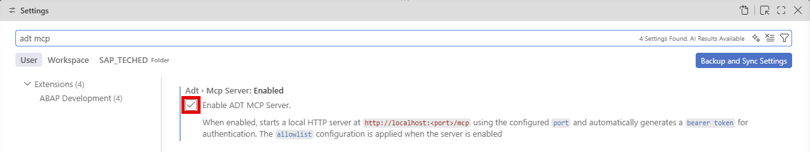
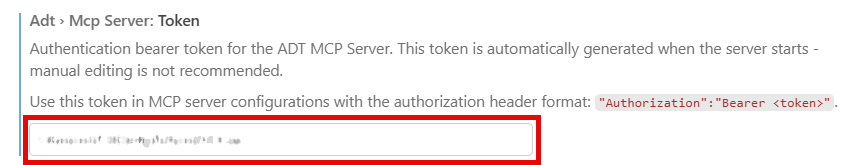
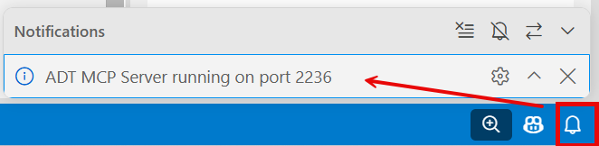
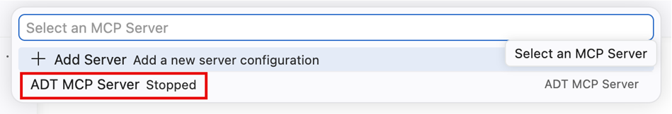
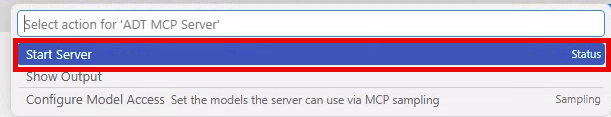
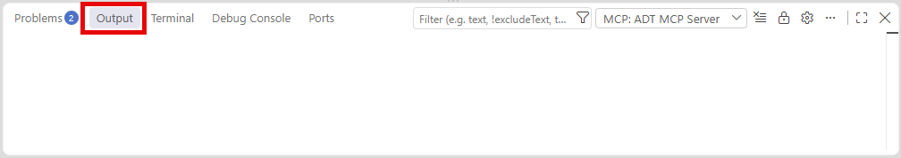
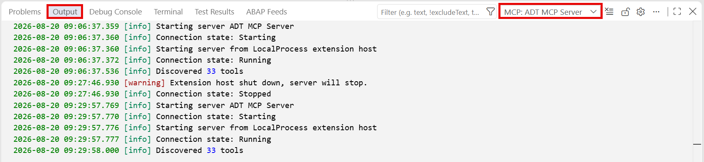
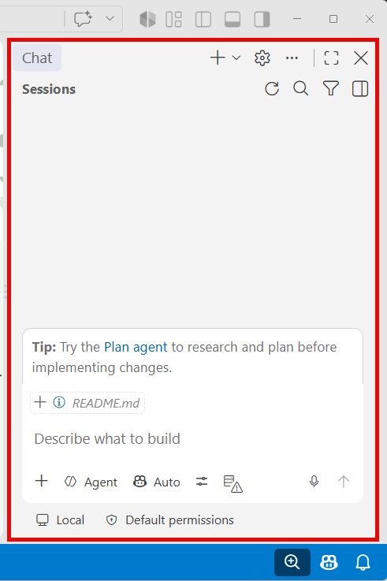
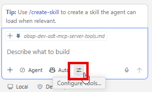
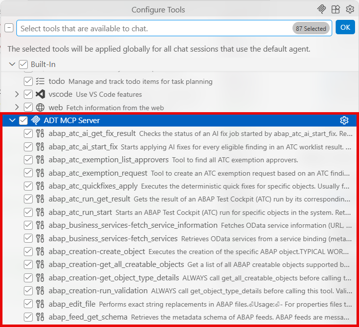

[Home - AD160 - Build apps and web APIs with ABAP Cloud using agentic AI](../../README.md)

# Exercise 1: Get-to-Know and Verify the Enablement of the ADT MCP Server

## Introduction
The [Model Context Protocol (MCP)](https://modelcontextprotocol.io/docs/2026-07-28/getting-started/intro) is an open-source standard that allows AI models to securely communicate with external tools, applications, and data sources through a common protocol.

The **ABAP Development Tools for VS Code** (ADT) extension contains the ADT MCP server that provides the ADT MCP tools. Theses tools connect your ABAP system on base of the ADT language server. They execute the relevant functionalities in the backend.  

> ℹ️ **Info**: In this handson session, you will use your coding agent in **Agent** mode together with the ADT MCP tools to generate a RAP UI service using the ABAP Cloud Generator and to create a complete transactional app (Travel + Booking RAP business object)—all driven by natural language prompts using the coding agent provided in the **Chat** view.

---

<!--
## Prerequisite
 To work with agentic-based ABAP development, you need to install a supported coding agent, e. g. [GitHub Copilot](https://github.com/features/copilot) and to purchase a license for it.

To use the ADT MCP tools in ADT for VS Code, the ADT MCP server needs to run. To enable the ADT MCP server, see the tutorial [Enable the ADT MCP Server in ABAP Development Tools for VS Code](https://developers.sap.com/tutorials/abap-dev-adt-mcp-server-tools).

---

-->

### Exercises

- [1.1 - Verify the Enablement of the ADT MCP Server](#exercise-11-verify-the-enablement-of-the-adt-mcp-server)
- [1.2 - Verify the ADT MCP Server is Running](#exercise-12-verify-the-adt-mcp-server-is-running)
- [1.3 - Verify the ADT MCP Tools in your coding agent](#exercise-13-verify-the-adt-mcp-tools-in-your-coding-agent)
- [Summary & Next Exercise](#summary--next-exercise)

> ℹ️ **Reminder**: Don't forget to replace all occurrences of the placeholder **'###'** with your group ID in the exercise steps below.

---

## Exercise 1.1: Verify the Enablement of the ADT MCP Server

The **ADT MCP Server** is a local HTTP server that is integrated in and runs inside the ADT extension. It implements the Model Context Protocol (MCP) to call tools in a structured, authenticated way and exposes ABAP development capabilities as MCP tools. 

This means, the ADT MCP server exposes a set of ABAP development tools to any MCP-compatible AI assistant. This allows you to create packages, to create transport requests, to generate complete RAP applications, activate objects, and more through natural language prompts.  

> ℹ️ **Info**: 
>- For this SAP-driven event, the ADT MCP server is already enabled in your ADT for VS Code installation on your laptop.  
>- In this workshop, the exercises use **GitHub Copilot** (see [Quickstart for GitHub Copilot](https://docs.github.com/en/copilot/get-started/quickstart)) as the coding agent. Any coding agent that supports Visual Studio Code's virtual workspace filesystem is compatible. GitHub Copilot is confirmed. Others are also supported.

<details>
  <summary>🔵 Click to expand</summary>

<!--
**Key tools available through the ADT MCP Server:**  
For example, the following ADT MCP tools are available:

| Tool | Description |
|------|-------------|
|abap_activate_objects|Activates ABAP objects in the ABAP system|
|abap_atc_apply_ai|Start applying AI fixes for every eligible finding in an ATC worklist result|
|abap_atc_execute_deterministic_quickfixes|Executes the deterministic quick fixes|
|abap_atc_run|Gets the result of an ABAP Test Cockpit (ATC) run by its corresponding worklist|
|abap_createion-crate_object|Executes the creation of ABAP development objects|
|abap_creation-get_all_createable_objects|Gets a list of all ABAP createable objects|
|abap_creation-get_object_type_details|Gets details required for creating an ABAP object such as name, description|
|abap_generators-generate_objects|Validates and generates ABAP RAP objects using the RAP generator|
|abap_generators-list_generators|Lists the available ABAP RAP generators|
|abap_list_destinations|Gets a list of available destinations in an ABAP system|
|abap_run_unit_tests|Runs ABAP unit tests for a given set of objects|
|abap_transport-create|Creates a transport request|
|abap_transport-get|Validates and displays relevant transport requests for a given object|
|
-->

> ⚠ **Warning regarding AI outputs** ⚠  
> The ADT MCP Server is an **experimental feature** that may change at any time without notice. It is not intended for productive use. Please back up your data before using it.

> **Further reading**:
>- [ADT MCP Tools](https://help.sap.com/docs/abap-cloud/abap-development-tools-for-visual-studio-code/mcp-tools?locale=en-US) 
>- [Model Context Protocol (MCP)](https://modelcontextprotocol.io/)
>- [ADT Security Considerations and Recommendations](https://help.sap.com/docs/abap-cloud/abap-development-tools-for-visual-studio-code/security-recommendations-and-considerations)  
>- [Agentic AI for ABAP Development](https://help.sap.com/docs/abap-cloud/abap-development-tools-for-visual-studio-code/agentic-ai-development?locale=en-US)  


> Verify the enablement the built-in ADT MCP Server in the Visual Studio Code extension settings.

1. Open the settings of **Visual Studio Code** as follows:  

   a. Open the **Command Palette** with **`Ctrl+Shift+P`** (macOS: **`Cmd+Shift+P`**)  
   b. Type **Preferences: Open Settings (UI)** and select the finding.

2. In the search bar, type:
   ```
   adt mcp
   ```
    The findings in the **Extensions > ABAP Development** node are displayed.

3.  Locate the **Adt: Enable MCP Server** setting (or similar) and enable it by checking the checkbox.

      

      ℹ️ **Hint**: You can also switch to JSON mode (click the '{}' icon top-right in settings) and add:  
      ```
      json 'adt.mcpServer.enabled': true
      ```

4. Optionally, you can configure the **MCP server port** (default: '2236').  
   > ℹ️ **Note**: Only change this if port 2236 is occupied on your machine. Proceed as follows:  
   a. Search for **ADT MCP port** in the settings.   
   b. Set it to the available port between '0' and '65535'.

5. **Reload Visual Studio Code** if prompted, or close and reopen the application.

   

   > ⚠️ **Important**: Make sure your system destination is still added to the workspace and you are logged on the to the ABAP system. The ADT MCP server only starts once a destination is active in the workspace.  
   > When starting the ADT MCP server, a token is initially generated and will be used to access the ADT MCP Server.  
   >   
   <!--
   > If you want to use only destinations, packages, and namespaces that are configured in the predefined allow list, you can set the **Adt > Mcp Server: Allowlist Enabled**. For this tutorial, you do not need to select this option.  
   > 
   -->
   
</details>

---

## Exercise: 1.2 Verify the ADT MCP Server is Running
[^Top of page](#)

> Check and confirm that the ADT MCP Server started successfully.

<details>

After enabling the setting and having a destination in the workspace, the server should start automatically.

**Method 1: Check for the startup notification**

1. Look at the bottom-right corner for a notification in the status bar:
   ```
   ADT MCP Server running on port 2236.
   ```
   

   > ℹ️ If you don't see the notification, proceed to Method 2.  

**Method 2: Check via MCP Server list**

1. Open the **Command Palette** (**`Ctrl+Shift+P`**).

2. Type ...  
   ```
   >MCP:List Servers
   ```

3. Select **`MCP: List Servers`** from the list.  

    You should then see an entry for **ADT MCP Server** in the quick pick list.
   
   

4. Select it and click **Start Server** if it is not already running.

   

**Method 3: Check the display in the Output view**

5. Open the **Output** view beneath the editor.

   

6. Select **MCP: ADT MCP Servers** from the drop-down list. Then, the status will be displayed in the **Output** view.

   

**Troubleshooting**

If the ADT MCP Server does not appear or fails to start:

1. Disable and re-enable the **Adt: Enable MCP Server** setting.

2. Remove the destination folder from the workspace and **add it back** from the Command Palette:
   ```
   ABAP: Add Destination as Folder to the Workspace...
   ```

3. Restart Visual Studio Code.

</details>

---

## Exercise: 1.3 Verify the ADT MCP Tools in your coding agent
[^Top of page](#)

> Open the **Chat** view of your coding agent in the agent mode. Confirm that the ADT MCP tools are loaded and available.

<details>


1. If the **Chat** view is not displayed by default, open the GitHub Copilot **Chat** view in Visual Studio Code.

      

    > ℹ️ **Note**: You have the following possiblities to do this:  
    >- Click the **Copilot** icon in the **Activity Bar** (left),
    >- choose *`View`* > *`Chat`* from the menu, or
    >- press **`Ctrl+Shift+I`** (macOS: **`Cmd+Shift+I`**)

2. Click the **Configure Tools** (tools wrench icon) button in the Copilot chat input bar.  
   A quick pick list appears showing available tool providers. 

      

      Here, you see the **ADT MCP Server** node with a list of the available tools, e.g., 'abap_generators-list_generators', 'abap_creation-create_object', and so on.

      

      

   > ✅ If you see the ADT MCP Server and its tools listed, your setup is complete!

3. Check and ensure the ADT MCP Server tools are **checked/enabled** in the list.

</details>

---

## Summary & Next Exercise
[^Top of page](#)

Now that you've:
- Enabled the ADT MCP server

you can continue with the next exercise — **[Exercise 2: Publish the RAP UI Service and Preview the Travel App](../ex02/README.md)**

----
