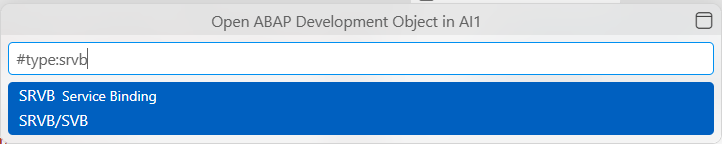
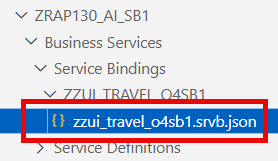
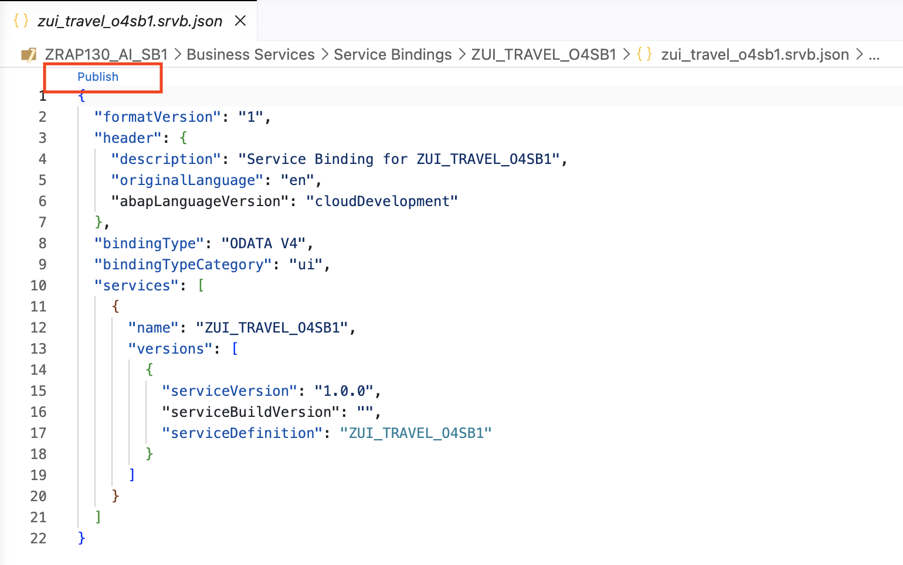
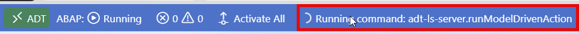
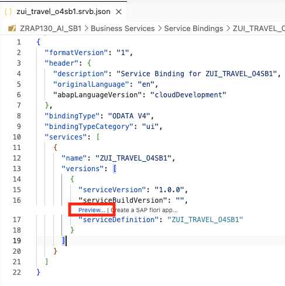
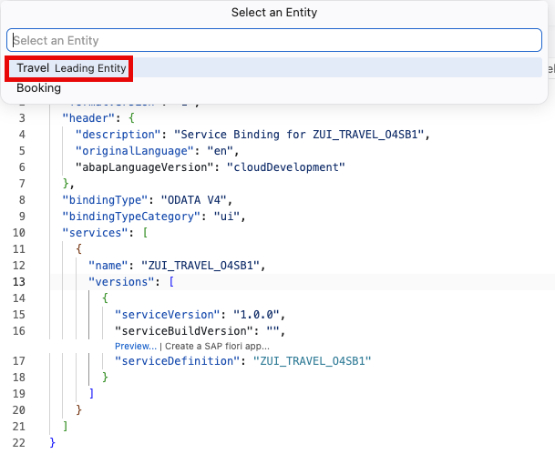
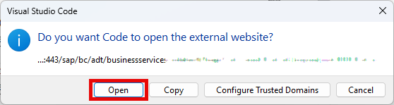

[Home - AD160 - Build apps and web APIs with ABAP Cloud using agentic AI](../../README.md)

# Exercise 3: Generate a RAP UI Service and Preview the Travel App with ADT MCP Tools

## Introduction

In this exercise, you will publish the local service endpoint of your OData V4 service binding and open the **Preview** in your default browser, to see the running Travel application.

---

### Exercises

- [3.1 - Publish the RAP UI Service](#exercise-31-publish-the-rap-ui-service)
- [3.2 - Preview the Travel App in the Browser](#exercise-32-preview-the-travel-app-in-the-browser)
- [Summary & Next Exercise](#summary--next-exercise)

> ℹ️ **Reminder**: Don't forget to replace all occurrences of the placeholder **'###'** with your group ID in the exercise steps below.

---

## Exercise 3.1: Publish the RAP UI Service
[^Top of page](#)

> Publish the local service endpoint of the service binding **'ZUI_TRAVEL_O4###'** to make the OData service available for preview and consumption.

  
🔵 Click to expand!

1. Open the service binding using **'Ctrl+Shift+A'** and search for **'ZUI_TRAVEL_O4###'**. 

2. Enter *'#type:SRVB'* and select the entry **Service Binding** (SRVB).

3. Click the **Publish** code lens on top in the editor.

   > ℹ️ The "Publish" action registers a local service endpoint that allows the  preview and external consumers to discover the service.  

   

   

5. Wait for the publishing to be completed. 

   > ✅ You should see on the bottom _Publish/unpublish action in progress_.

      

---

## Exercise 3.2: Preview the Travel App in the Browser
[^Top of page](#)

> Preview the app for the travel entity in your default browser.

  
🔵 Click to expand!

1. Open your service binding **'ZUI_TRAVEL_O4###'** and click the **Preview** code lens in the source code.

   

2. In the dialog to be opened, select the 'Travel' entity. 
   
   

3. In the dialog to be opened of you operating system, choose **Open** to confirm opening the link in your default browser.

   

   You default browser is opened and displays the **Preview** for your **Travel** application.

3. Try creating a new 'Travel' entity as follows:  
   a. Click **Create** and enter some fields, such as **Destination**, **Starting Date**, **End Date**.  
   b. Fill in **Agency ID** and **Customer ID** (Note: Use any valid IDs from the DMO flight reference data, e.g., '070001' for Agency, '000001' for Customer).  
   c. Confirm with **Save**.

   > ✅ If you can create and save a Travel entry, the app is working correctly!

---

## Summary & Next Exercise
[^Top of page](#)

Now that you've:
- Published the local service endpoint of the service binding **'ZUI_TRAVEL_O4###'**
- Opened and tested the preview of the app in the browser
- Created a test travel entry to verify the RAP UI service is working

You can continue with the next exercise — **[Exercise 4: Add a Validation](../ex04/README.md)**

---
