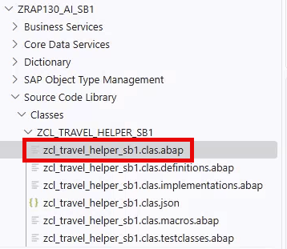
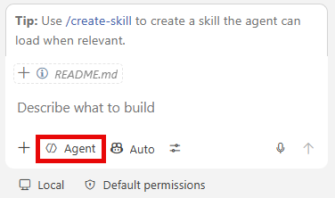
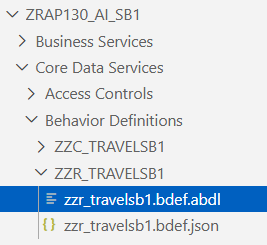
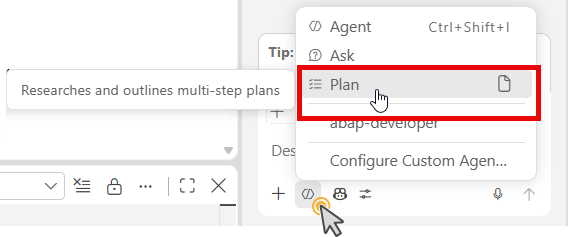
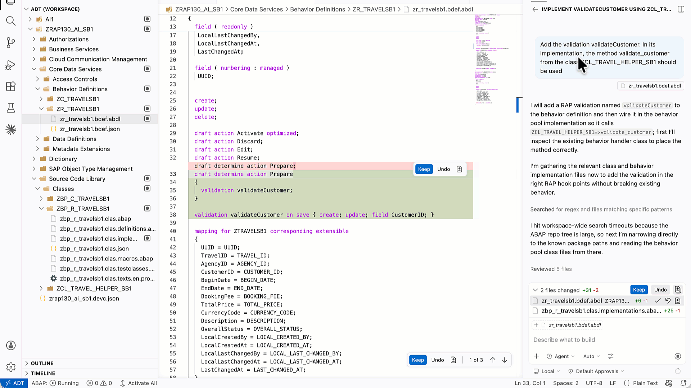
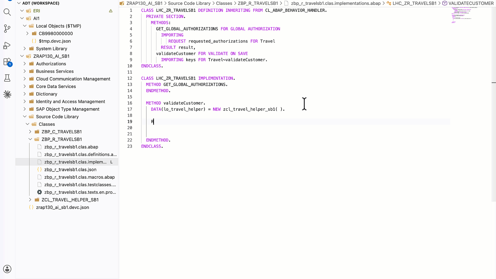
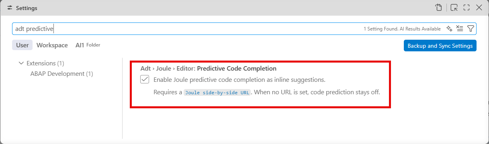
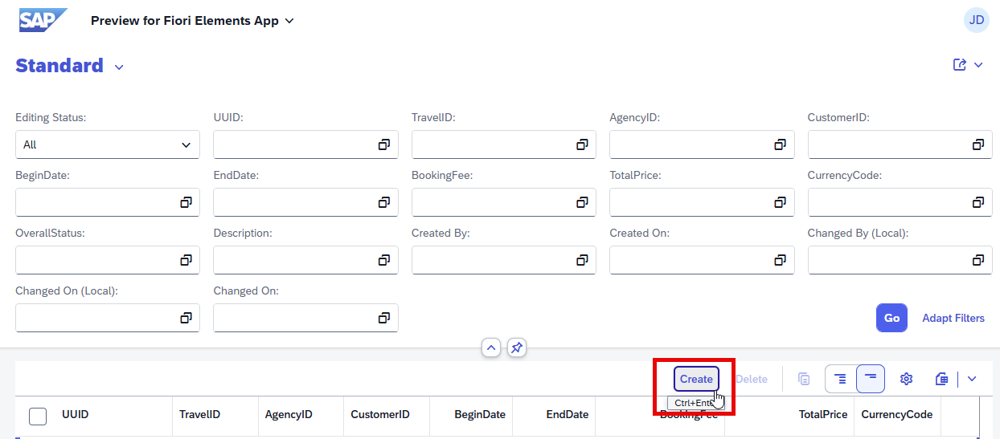
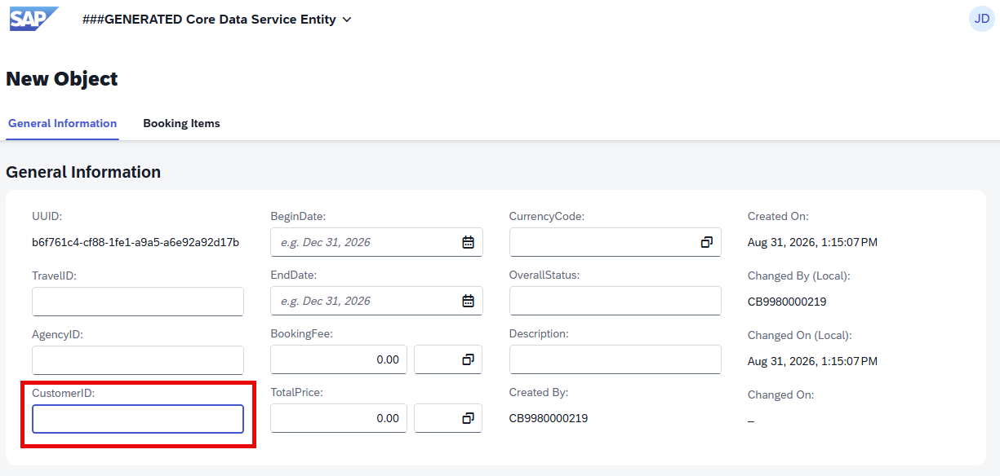
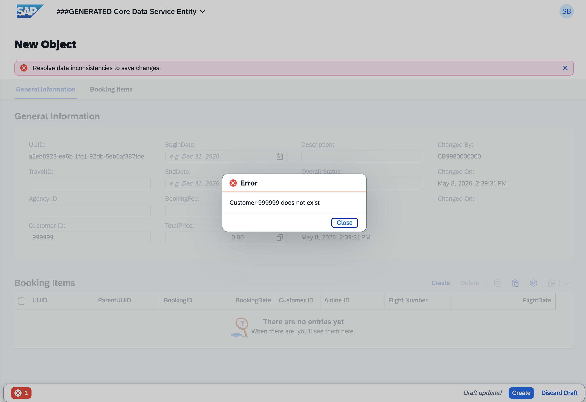

[Home - AD160<!--RAP130--> - Build apps and web APIs with ABAP Cloud using agentic AI](../../README.md)

# Exercise 4: Add a Validation

## Introduction

In this exercise, you will use your coding agent in **Agent** mode to define and implement a backend [**validation**](https://help.sap.com/docs/abap-cloud/abap-rap/validations) called **'validateCustomer'** in a single step. Both, the behavior definition declaration and the behavior pool implementation, will be handled by your coding agent.

### Exercises

- [4.1 - Create an ABAP helper class](#exercise-41-create-an-ABAP-help-class)
- [4.2 - Define and Implement the Validation](#exercise-42-define-and-implement-the-validation)
- [4.3 - Preview and Test the Enhanced Travel App](#exercise-43-preview-and-test-the-enhanced-travel-app)
- [Summary & Next Exercise](#summary--next-exercise)

> ℹ️ **Reminder**: Don't forget to replace all occurrences of the placeholder **'###'** with your group ID in the exercise steps below.

---

## Exercise 4.1: Create an ABAP helper class
[^Top of page](#)

> Create a helper class to validate the customer demo data of the [ABAP Flight Reference Scenario](https://help.sap.com/docs/ABAP_PLATFORM_NEW/fc4c71aa50014fd1b43721701471913d/a9d7c7c140a0408dbc5966c52d156b49.html?version=latest).

<details>
  <summary>🔵 Click to expand!</summary>

1. Open the **Command Palette** (**'Ctrl+Shift+P'**) and type 'ABAP: Create new ABAP Object' or use **'Ctrl+Shift+Alt+N'** (macOS: **'Cmd+Option+Shift+N'**) to create a new ABAP Class.

   - Package: **'ZAD160_AI_DEMO_###'**
   - Name: **'ZCL_TRAVEL_HELPER_###'**
   - Description: **'Travel helper class ###'**  
  
    > ℹ️ **Note**: You can skip the entries for 'Superclass' and 'Interface'. The class **'ZCL_TRAVEL_HELPER_###'** should have been created successfully

   


2. Paste the following code into the class, replacing **'###'** with your group ID:

   ```ABAP
   CLASS zcl_travel_helper_### DEFINITION
     PUBLIC
     FINAL
     CREATE PUBLIC.

     PUBLIC SECTION.
       METHODS: validate_customer
                  IMPORTING iv_customer_id TYPE /dmo/customer_id
                  RETURNING VALUE(rv_exists) TYPE abap_bool.

     PROTECTED SECTION.
     PRIVATE SECTION.
   ENDCLASS.

   CLASS zcl_travel_helper_### IMPLEMENTATION.

     METHOD validate_customer.
       SELECT SINGLE
         FROM /dmo/customer
         FIELDS @abap_true AS line_exists
         WHERE customer_id = @iv_customer_id
         INTO @rv_exists.
     ENDMETHOD.

   ENDCLASS.
   ```

3. Save (**'Ctrl+S'**) and activate (**'Ctrl+F3'**) the class.
<!--
4. Preview the data that is provided through the ABAP helper class.
   
   a. Open the **ZR_BOOKING_###* CDS table entity in the editor.

   b. Open the **Command Palette** with **'Ctrl+Shift+P'** (macOS: **'Cmd+Shift+P'**) and type '>ABAP:New SQL Notebook'. Select then **>ABAP:New SQL Notebook**.

   c. Enter the SQL statement to display the content of the data source.

   ```
   SELECT *
   FROM zr_booking
   ```  
   The relevant data is displayed in the **Output** panel at the bottom.
-->
</details>

---

## Exercise 4.2: Define and Implement the Validation
[^Top of page](#)

> Use your coding agent in **Agent** mode to declare 'validateCustomer' in the behavior definition **'ZR_TRAVEL###'** and implement it in **'ZBP_R_TRAVEL###'** in one go.

 

> ⚠ **Warning regarding AI outputs** ⚠  
> Please be aware that the outputs generated by AI in this exercise description may differ from yours.  
> **!!Always review the generated code before activating!!**

<details>
  <summary>🔵 Click to expand!</summary>

1. Open the behaviour definition **'ZR_TRAVEL###'**, that is provided in the **Core Data Services** folder, in the edior. 

     

2. Go to **Chat** view and enter the following prompt and run then the agent:

   > 💡 Tip: You can start in **Plan** mode first to preview the changes the coding agent intends to make and then switch back to **Agent mode** to execute them.

   

   ```
   Add the validation validateCustomer. 
   
   In its implementation, the method validate_customer from the ABAP Class ZCL_TRAVEL_HELPER_### should be used.  

   Add the validation to the prepare action.
   
   Ask to review changes before proceeding with the activation.
   ```

3. Your coding agent will propose changes to both the behavior definition and the implementation class. 

> ⚠ **Warning regarding AI outputs** ⚠  
**Review the changes carefully** before confirming.

4. Allow and confirm activation when Copilot asks.

   

   > ℹ️ **Note**: In case of any errors, use the **Chat** view and enter a prompt to solve the issue.

   As a result, your code should look something like this:
  
   <details>

   ```ABAP
      CLASS LHC_ZR_TRAVEL### DEFINITION INHERITING FROM CL_ABAP_BEHAVIOR_HANDLER.
         PRIVATE SECTION.
            METHODS:
               GET_GLOBAL_AUTHORIZATIONS FOR GLOBAL AUTHORIZATION
               IMPORTING
                  REQUEST requested_authorizations FOR Travel
                  RESULT result,
                  validateCustomer FOR VALIDATE ON SAVE
                  IMPORTING keys FOR Travel~validateCustomer.
      ENDCLASS.
         
      CLASS LHC_ZR_TRAVEL### IMPLEMENTATION.
         METHOD GET_GLOBAL_AUTHORIZATIONS.
         ENDMETHOD.

         METHOD validateCustomer.
            DATA(lo_travel_helper) = NEW zcl_travel_helper_###( ).

            READ ENTITIES OF zr_travel### IN LOCAL MODE
               ENTITY Travel
               FIELDS ( CustomerID )
               WITH CORRESPONDING #( keys )
               RESULT DATA(lt_travel).

            LOOP AT lt_travel INTO DATA(ls_travel).
               IF lo_travel_helper->validate_customer( ls_travel-CustomerID ) = abap_false.
               APPEND VALUE #( %tky = ls_travel-%tky ) TO failed-travel.
               APPEND VALUE #(
                  %tky = ls_travel-%tky
                  %msg = new_message_with_text(
                     severity = if_abap_behv_message=>severity-error
                     text     = |Customer { ls_travel-CustomerID } does not exist| ) )
                     TO reported-travel.
                  ENDIF.
               ENDLOOP.
            ENDMETHOD.
         ENDCLASS.
      ```  
   </details>

 5. **OPTIONAL**: You can also experiment and implement the validation 'validateCustomer' using [**Predictive Code Completion**](https://help.sap.com/docs/abap-cloud/abap-development-tools-for-visual-studio-code/using-predictive-code-completion-a17bf386464447e8bf095ea4db277352).  

   
   
   > ℹ️ **Note**: Predictive code completion may also propose code that is generated by other LLMs.

   To use predictive code completion, you need to enable the respective setting at first. Proceed as follows:

   a. Open the **Command Palette** with **'Ctrl+Shift+P'** (macOS: **'Cmd+Shift+P'**) and type 'Preferences: Open Settings (UI)'. Select **Preferences: Open Settings...**.  
   
   b. In the search bar, type:

      ```
      adt predictive
      ```

   c. Locate the setting **"Adt > Joule > Editor: Predictive Code Completion"** setting and enable the **Enable Joule predictive code completion as inline suggestions** checkbox.

   

</details>

---

## Exercise 4.3: Preview and Test the Enhanced Travel App
[^Top of page](#)

<!-- To fill the database /dmo/customer, tutors need to run '/dmo/cl_flight_data_generator' class to generate data in advance!! -->

> Test the 'validateCustomer' validation in the preview.

<details>
  <summary>🔵 Click to expand!</summary>

1. Open the service binding **'ZUI_TRAVEL_O4###'** (use **'Ctrl+Shift+A'** to find it), select the **Travel** entity, and click the **Preview** code lens in the editor.

2. In the app, click **Create** to start a new travel entry.

      

3. In the **Customer ID** field, enter an **invalid customer ID** — for example, '999999'.

      


4. Click **Save**.

   > ✅ The app should display a validation error message: **"Customer 999999 does not exist"** (or similar). The save is rejected.

   

6. Now correct the **Customer ID** to a valid one (e.g., '000001') and click **Save** again.

   > ✅ The travel entry is saved successfully.

</details>

---

## Summary & Next Exercise
[^Top of page](#)

Now that you've:
- Used your coding agent in Agent mode to define and implement the 'validateCustomer' validation in one step
- Tested the validation in the Preview—confirming that invalid customer IDs are rejected

you can continue with the optional exercises:
- **[Exercise 5: Generate ABAP Unit Tests](../ex05/README.md)**
- **[Exercise 6: Debug ABAP Code in Visual Studio Code (*Optional*)](../ex06/README.md)**
- **[Exercise 7: Add a Field to the Existing RAP UI Service (*Optional*)](../ex07/README.md)**

---
