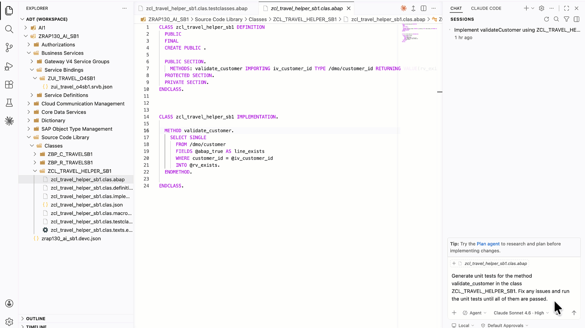
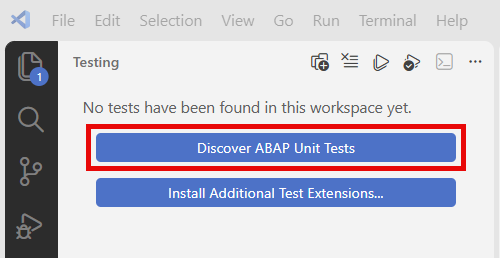
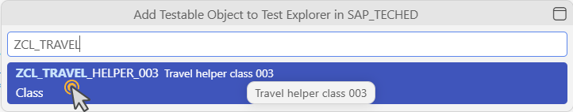
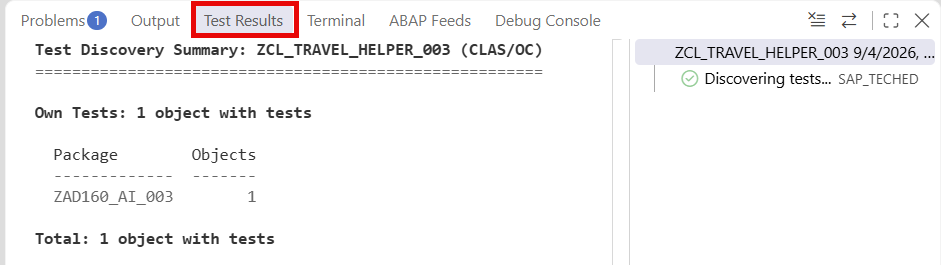
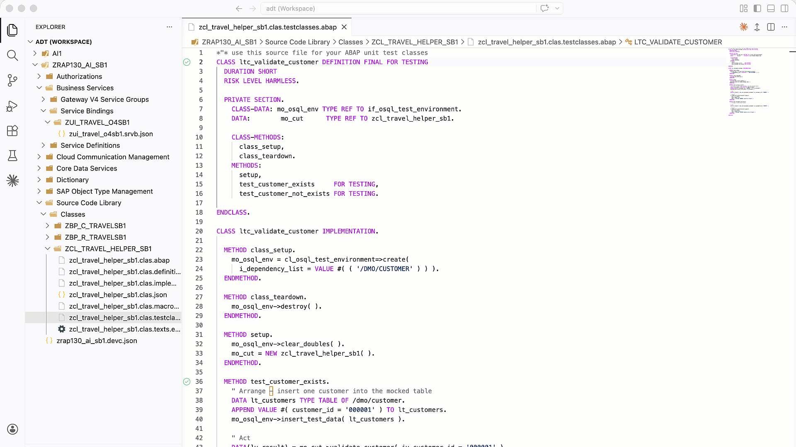

[Home - AD160 (aka RAP130) - Build apps and web APIs with ABAP Cloud using agentic AI](../../README.md)

# Exercise 5: Generate ABAP Unit Tests

## Introduction

In this exercise, you will generate ABAP Unit tests for the ABAP helper class **'ZCL_TRAVEL_HELPER_###'**, fix any issues, and run the tests—all in a single step in your package 'ZAD160_AI_DEMO_###'.

### Exercises

- [5.1 - Generate and Run ABAP Unit Tests](#exercise-51-generate-and-run-abap-unit-tests)
- [Summary](#summary)

> ℹ️ **Reminder**: Don't forget to replace all occurrences of the placeholder **'###'** with your group ID in the exercise steps below.

---

## Exercise 5.1: Generate and Run ABAP Unit Tests
[^Top of page](#)

> Use your coding agent in **Agent** mode to generate ABAP Unit tests for **'ZCL_TRAVEL_HELPER_###'**, fix any issues, and run the tests until all pass.

> ⚠ **Warning regarding AI outputs** ⚠
> The outputs, generated by the coding agent in this exercise description, may differ from yours. **Always review the generated test code before running it.**

<details>
  <summary>🔵 Click to expand!</summary>

1. Open **Chat** view in **Agent mode**.

   > 💡 **Tip**: Start in **Plan** mode first to preview the changes. The coding agent intends to switch to **Agent** mode in order to execute them.

2. Enter the following prompt:

   ```
   Generate ABAP Unit tests for the method validate_customer in the class ZCL_TRAVEL_HELPER_###.  
   
   Fix any issues and run the ABAP Unit tests until all of them are passed.
   ```
   > ℹ️ **Note**: Your coding agent will create the test class, generate test methods, fix any issues, and run the tests iteratively until all pass. 
   During this process it will call the MCP tools **'abap_activate-objects'** and **'abap_run_unit_tests'**. Allow these tool calls when prompted.

3. Review the test results in the **Test Results** panel.  

   

   If the **Testing** panel is not displayed, you can open it as follows:

   a. Choose *View* > *Testing* from the menu.

   b. If no test has been found, choose the **Discover ABAP Unit Test** button in the primary side bar.

      

   c. Select the ABAP helper class with the ABAP Unit test.

      

      The test runs and its result is displayed in the **Test Results** panel at the bottom.

      

4. **Optionally** Double-check by running the ABAP Unit tests manually. Open the **Command Palette** (**'Ctrl+Shift+P'** / **'Cmd+Shift+P'**) and select **>ABAP: Run Unit Tests**.

   

   Your code should look something like this:
   
   <details>

      ```ABAP        
      CLASS ltc_validate_customer DEFINITION FINAL FOR TESTING
         DURATION SHORT
         RISK LEVEL HARMLESS.

         PRIVATE SECTION.
            CLASS-DATA: mo_osql_env TYPE REF TO if_osql_test_environment.
            DATA:        mo_cut      TYPE REF TO zcl_travel_helper_###.

            CLASS-METHODS:
               class_setup,
               class_teardown.
            METHODS:
               setup,
               customer_exists     FOR TESTING,
               customer_not_exists FOR TESTING.

      ENDCLASS.

      CLASS ltc_validate_customer IMPLEMENTATION.

         METHOD class_setup.
            mo_osql_env = cl_osql_test_environment=>create(
               i_dependency_list = VALUE #( ( '/DMO/CUSTOMER' ) ) ).
         ENDMETHOD.

         METHOD class_teardown.
            mo_osql_env->destroy( ).
         ENDMETHOD.

         METHOD setup.
            mo_osql_env->clear_doubles( ).
            mo_cut = NEW zcl_travel_helper_###( ).
         ENDMETHOD.

         METHOD customer_exists.
            " Arrange – insert one customer into the mocked table
            DATA lt_customers TYPE TABLE OF /dmo/customer.
            APPEND VALUE #( customer_id = '000001' ) TO lt_customers.
            mo_osql_env->insert_test_data( lt_customers ).

            " Act
            DATA(lv_result) = mo_cut->validate_customer( iv_customer_id = '000001' ).

            " Assert
            cl_abap_unit_assert=>assert_equals(
               act = lv_result
               exp = abap_true
               msg = 'Customer 000001 should be found' ).
         ENDMETHOD.

         METHOD customer_not_exists.
            " Arrange – table stays empty

            " Act
            DATA(lv_result) = mo_cut->validate_customer( iv_customer_id = '999999' ).

            " Assert
            cl_abap_unit_assert=>assert_equals(
               act = lv_result
               exp = abap_false
               msg = 'Customer 999999 should not be found' ).
         ENDMETHOD.

      ENDCLASS.
      ```
   </details>
</details>

---

## Summary
[^Top of page](#)

Congratulations! You have completed all relevant exercises of this tutorial.

In this final exercise, you've:
- used your coding agent in Agent mode to generate ABAP Unit tests for 'ZCL_TRAVEL_HELPER_###' in one step.
- let your coding agent fix any issues and run the tests iteratively until all passed.

You can continue with the other optional exercises:
- **[Exercise 6: Debug ABAP Code in Visual Studio Code](../ex06/README.md)**
- **[Exercise 7: Add a Field to the Existing RAP UI Service (*Optional*)](../ex07/README.md)**

---