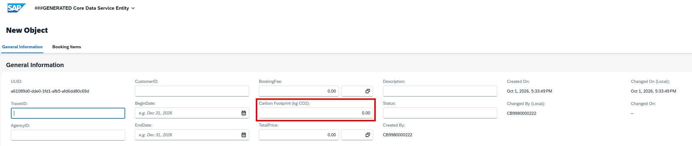
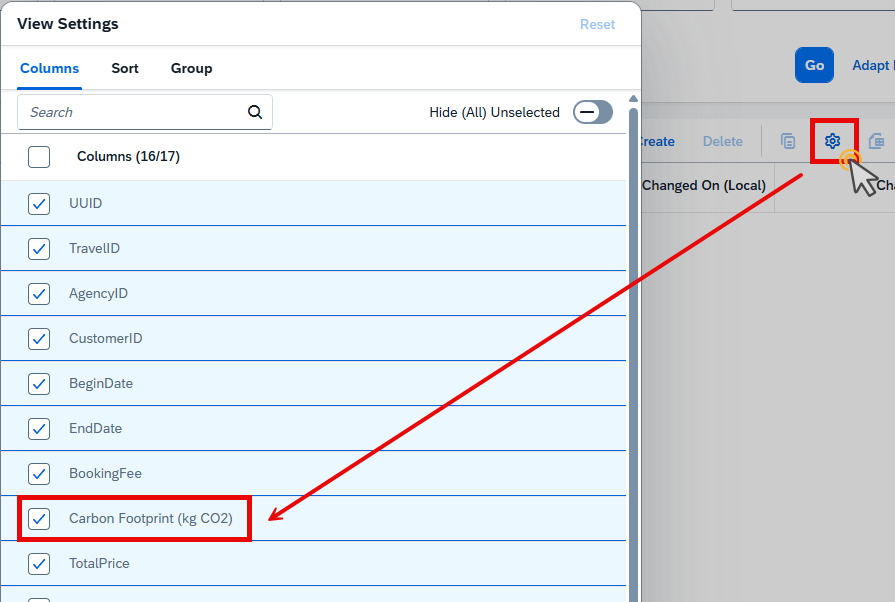
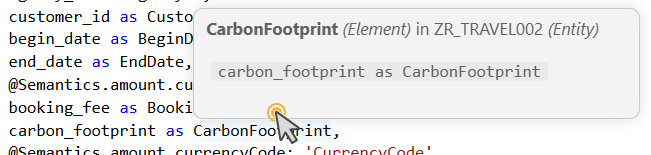

[Home - AD160 - Build apps and web APIs with ABAP Cloud using agentic AI](../../README.md)

# Exercise 7: Add a Field to the Existing RAP UI Service _(Optional)_

## Introduction

In this exercise, you will add a new field and implement its business logic in the generated RAP UI service using a coding agent, e.g. GitHub Copilot. 

### Exercises

- [7.1 - Analyze the Business Object](#exercise-71-analyze-the-business-object)
- [7.2 - Extend the ABAP Data Model](#exercise-72-extend-the-abap-data-model)
- [7.3 - Preview and Test the App](#exercise-73-preview-and-test-the-app)
- [7.4 - Implement the Business Logic](#exercise-74-implement-the-business-logic)
- [7.5 - Handle Side Effects](#exercise-75-handle-side-effects)
- [7.6 - Review the Implementation and Re-Test the App again](#exercise-76-review-the-implementation-and-re-test-the-app-again)
- [Summary](#summary)

> ℹ️ **Reminder**: Don't forget to replace all occurrences of the placeholder **'###'** with your group ID in the exercise steps below.

### Learning Objectives

After completing this exercise, you can:  
- Use coding agent, e.g. GitHub Copilot, for end-to-end RAP enhancements
- Analyze an existing RAP business object
- Extend CDS entities
- Adapt behavior implementations
- Expose fields through OData services
- Enhance the generated Fiori Elements UI
- Validate generated code in the app

### Development Goal

The travel department wants to track the sustainability impact of business trips. The new field **CarbonFootprint** shall be introduced. It stores the estimated CO₂ emissions of a trip in kilograms. The field shall be displayed in the **Travel** app and automatically calculated based on the booking fee.
The implementation shall be performed using a coding agent, e.g. GitHub Copilot, in agent mode.

---

## Exercise 7.1: Analyze the Business Object
[^Top of page](#)

> In the first step, you want to get an overview of the relevant travel business object and to identify all relevant artifacts.

<details>
  <summary>🔵 Click to expand!</summary>

1. Open the **Chat** (**`Ctrl+Shift+I`** / macOS: **`Cmd+Shift+I`**) view.

2. In the **Chat** view, use the **Agent** mode and type:

   ```markdown   
   The field CarbonFootprint should be added to the Travel business object and must be visible in the UI.
   
   Analyze the RAP travel application and identify all artifacts that must be changed. 
   
   Create an implementation plan only.  Do not change any files yet.  

   Display a list with the relevant development objects and its type.
   ```   
   
  The coding agent should identify the following object types:
  - CDS data definitions
  - CDS projection view
  - CDS metadata extension
  - Behavior definition
  - Behavior implementation
  - Projection behavior implementation, if the determination exporsure requires it
  - Service definition
  - Service binding
  - Database table
  - Data element

</details>

---

## Exercise 7.2: Extend the ABAP Data Model
[^Top of page](#)

> You want to add the new field and implement its metadata in the relevant development objects.

<details>
  <summary>🔵 Click to expand!</summary>

1. Open the **Chat** (**`Ctrl+Shift+I`** / macOS: **`Cmd+Shift+I`**) view.

2. In the **Chat** view, use the **Agent** mode and type:

   ```markdown  
   Implement the new field CarbonFootprint and extend the existing ABAP data model.
   
   Update all required database tables, CDS artifacts, and CDS metadata extensions.
   ```

The coding agent changes and activates the following development objects:
   - ZR_TRAVEL (root table entity)
   - ZR_TRAVEL_D (draft table entity)
   - ZC_TRAVEL (CDS projection view)
and lists them in the **Chat** view.

In these objects, the AI adda the new field as follows:

   ```
   CarbonFootprint : abap.dec(10,2)
   ```

</details>

---

## Exercise 7.3: Preview and Test the App
[^Top of page](#)

>Test if the extension and the UI annotations are available in the app. To do this, open the app in the default browser and verify the behavior of the AI-generated source code.

<details>
  <summary>🔵 Click to expand!</summary>

1. Open the generated **ZUI_TRAVEL_###** service binding.

2. Preview the app in the default browser or navigate to the browser in  which the app is already opened.

3. Check that the column **CarbonFootprint** has been added to the list view and that the field is visible in the object page as well.

     

In addition, you can test the implementation of the field:

1. Navigate within the ABAP data model to see where the new field had been added: 

    a. Open the **ZR_TRAVEL_###** CDS data definition.

    b. Go to the **CarbonFootprint** field within the selection list.

    c. Choose **F12** or **Go to Definition** from the context menu. 

    The **ZTRAVEL_###** database table will be opened and the cursor is positioned at the relevant occurence within the source code.  

  > ℹ️ **Info**: If the new field is not visible in the app, proceed then as follows:  
    >  a. If the app is still opened in the browser, just refresh it. Otherwise, preview it again from the service binding.  
    >  b. Choose the *Settings* icon with the gear from the chart toolbar and check if the new field is available in the Settings field catalog.  
  >
  >  


2. Display the element information of the type to get more details about the new field as follows:  

    a. Open a development object where the field **CarbonFootprint** has been added.

    b. Hover the type with the mouse and wait 2 seconds.

    The Hover feature of VS Code is opened and displays the element information.

     

</details>

---

## Exercise 7.4: Implement the Business Logic
[^Top of page](#)

>Define and implement a [determination](https://help.sap.com/docs/abap-cloud/abap-rap/determinations) to calculate the value for the field **CarbonFootprint**.

<details>
  <summary>🔵 Click to expand!</summary>

1. Open the **Chat** (**`Ctrl+Shift+I`** / macOS: **`Cmd+Shift+I`**) view.

2. In the **Chat** view, use the **Agent** mode and type:  

```markdown  
Implement automatic calculation of field CarbonFootprint.

Whenever the value of field booking_fee changes, field CarbonFootprint shall be recalculated in accordance.

The value of the carbon footprint should be 25% of the booking fee.

Use existing RAP patterns within the package.
```  
> ℹ️ **Info**:  You see whether the coding agent chooses ...
>- determination,
>- validation, or
>- save logic  
>and you must review the proposal.

The coding agent lists the development objects where the new business logic will be added and implemented. 

As a result, the a value of field **booking_fee** is calcuated.

</details>

---  

## Exercise 7.5: Handle Side Effects
[^Top of page](#)

>After implementing the business logic, the value of field **CarbonFootprint** will be calculated. However, the value on the screen will not be refreshed automatically. So, the user would be forced to refresh the browser manually.  

To achieve a better user experience for users, the content of the field **CarbonFootprint** needs to be refreshed automtically. To do so, implement [side effects](https://help.sap.com/docs/abap-cloud/abap-rap/developing-side-effects).

<details>
  <summary>🔵 Click to expand!</summary>

1. Open the **Chat** (**`Ctrl+Shift+I`** / macOS: **`Cmd+Shift+I`**) view.

2. In the **Chat** view, use the **Agent** mode and type:  

```markdown  
Add side effects so that field CarbonFoodPrint gets reloaded when field bookingfee has been updated.
```

</details>

---

## Exercise 7.6: Review the Implementation and Re-Test the App again
[^Top of page](#)

>Test the behavior of the generated source code again. Review the current changes related to field **CarbonFootprint**. 

Verify ...  
    - side effects  
    - exposure in the RAP UI service 
    - UI visibility  
    - syntax issues  

<details>
  <summary>🔵 Click to expand!</summary>

1. Open the default browser where the app is currently running.

2. Verify the app if side effects are considered:  

    a. Open the app.
    
    The card is initially displayed.

    b. Open the entry you have created.

    c. Choose **Edit** to adapt the entry.

    d. Enter a new booking fee and click into another field.

    The value of the field **CarbonFootprint** should be recalculated and be adopted in accordance.

</details>

---

## Summary
[^Top of page](#)

In this exercise, you've:
- analyzed the relevant business objects about the impact when adding a new field
- started implementing a ABAP data model extension.
- implemented the business logic by calculating the value automatically.
- exposed the field by making the field available through the service.
- adapted the UI annotations to display the field in the object page and list report.
- triggered a validation to test if the field is added as expected.

---

### What you built in this workshop

Over the course of AD160, you have:

1. ✅ Set up Visual Studio Code with the ADT extension and connected to an ABAP system
2. ✅ Verified the enablement of the ADT MCP Server with your coding agent
3. ✅ Generated a complete RAP UI service using AI-driven ADT MCP tool calls
4. ✅ Explored and adjusted the generated artifacts in Visual Studio Code
5. ✅ Published the service and previewed the app in the default browser
6. ✅ Added a validation
7. ✅ Generated and ran ABAP Unit tests 
8. ✅ Debugged your source code 
9. ✅ Enhanced the RAP UI service by adding a new field with Agentic AI

**[↑ Back to Tutorial Home](../../README.md)**

---